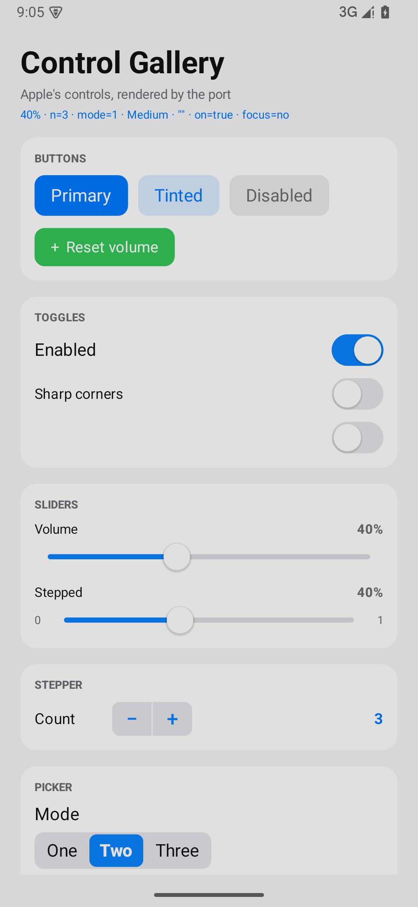

# SwiftUI for Android

> [!important]
>
> The repo is solely generated by DeepSeek V4.1 Flash 1017 without any human audit.
> You should **NEVER** (I don't believe anyone will) use it in production.
>
> It's interesting though...

SwiftUI source compiles for Android and runs there: `import SwiftUI`, `@State`, `VStack`, `Button`,
`Slider`, `TextField`, `ScrollView`. Two different things make that work, and it is worth being
precise about which is whose.

| | Apple's | This project's |
|---|---|---|
| `SwiftUI`/`SwiftUICore` **API declarations** (`Sources/SwiftUI/Generated/`, `port-shims/`) | taken from the `.swiftinterface` files and headers Apple ships in the iOS SDK, retargeted and recompiled | |
| `@inlinable` bodies inside those declarations | preserved verbatim | |
| View graph, layout, state and bindings, display list, canvas painter | | written here |
| Controls and how they look — including the built-in *styles*, which are this project's own design decisions, not Apple's | | written here |
| Text input, link opening, IME and `Intent` seams | | written here |
| Java host, JNI and C bridge, APK pipeline, build scripts | | written here |
| `Combine` (vendored) | OpenCombine, MIT (third party) | |

So this is **not** Apple's SwiftUI running on Android — Apple's engine is a closed-source Darwin
dylib bound to UIKit, QuartzCore/Metal and CoreText, and none of it executes here. It is also not a
lookalike API written from scratch: the declarations an app compiles against are Apple's, unchanged
apart from the target header. What sits underneath them — the layout engine, the renderer, the
state machinery, every control and its appearance — is an independent implementation, and that is
the larger part of the work.

No Jetpack Compose, no Kotlin UI, no source-to-source transpiler. Views are measured, placed and
painted by this repository's engine and drawn through `android.graphics.Canvas` over JNI.

## What runs today

Two apps, both ordinary SwiftUI source, both built from the same library:

| Demo | What it shows | Command | APK |
|---|---|---|---|
| **Atlas** | a four-screen app: tabs, state-driven navigation, feed, grid, detail, settings | `./scripts/dev.sh` | `build/SwiftUI-Android.apk` |
| **Control gallery** | the controls, their variants and modifiers, plus real IME text input | `./scripts/gallery.sh` | `build/SwiftUI-Gallery.apk` |

They install side by side (separate application ids), so the launcher has two icons.



```bash
./scripts/port/build-port-sdk.sh   # retarget Apple's interfaces, build shims + vendored Combine
./scripts/dev.sh                   # Atlas: build, install and launch
./scripts/gallery.sh               # control gallery: build, install and launch
./scripts/test.sh                  # engine unit tests, host side
SWIFTUI_PORT_GENERATED=0 ./scripts/dev.sh   # the older engine-level demo, for reference
```

## Why Apple's binary cannot be reused

`SwiftUI.framework` on iOS is a Mach-O dylib whose layout/text/render engine links against
**UIKitCore → QuartzCore/CA::Render → Metal/IOSurface**, and measures text through **CoreText**.
`SwiftUI.tbd` reexports `SwiftUICore`, `UIKit`, `CoreTransferable`, `DeveloperToolsSupport`;
`SwiftUICore` imports `Combine`, `CoreFoundation`, `Observation`, `Symbols`, `Spatial`, `os`,
`simd`, `Accessibility`. None of those exist on Android, the graphics ones are closed source, and
Metal has no Android equivalent. Running that dylib would mean porting iOS's userspace graphics
stack.

What *is* portable is what Apple publishes: the complete API as `.swiftinterface` text, which the
Swift frontend recompiles for any target.

| Apple artifact | Size | Content |
|---|---|---|
| `SwiftUI.swiftinterface` | 1.9 MB / 33,818 lines | 6,239 public declarations, 273 `@inlinable` bodies |
| `SwiftUICore.swiftinterface` | 1.4 MB / 27,839 lines | 2,533 declarations, 749 `@inlinable` bodies |
| `Symbols.swiftinterface` | 637 lines | SF Symbols API |
| `Combine.swiftinterface` | 2,590 lines | Combine (retargeted too) |
| `SwiftUI.tbd`, `SwiftUICore.tbd` | 1.8 MB | exported symbol tables / reexports |

Everything those interfaces declare but do not implement — 7,945 bodyless functions, properties
and initialisers by the current generator run — is a seam this repository has to fill. 608 of them
are the view-graph entry points (`body`, `_makeView`, `_makeViewList`, `_viewListCount`); the ones
the demos reach are implemented in `Sources/SwiftUI/Adapters/`, the rest still trap by name.

## How it works

```
iOS SDK .swiftinterface  ──retarget host triple──▶  build/port-sdk/gen/<Module>.swiftmodule
                                                          │  (Apple's declarations, unmodified)
Apple-only modules (UIKit, CoreGraphics, …)  ──shim──▶    │
                                                          ▼
                        Sources/SwiftUI/Generated/*.swift  (declarations Apple left bodyless,
                                                          │  @inlinable bodies preserved verbatim)
                        Sources/SwiftUI/Engine/*.swift  ──┤  (layout, state, DisplayList, painting)
                        Sources/SwiftUI/Adapters/*.swift ──┤  (Apple's declared types → engine nodes)
                        Sources/SwiftUIAndroid/*.swift  ──┤  (JNI entry points, canvas backend)
                        Sources/AndroidBridge/*.c       ──┤  (JNI + Canvas/Paint/Typeface bridge)
                        app/**  (Java host: Activity + View, IME overlay)
                                                          ▼
                                       build/SwiftUI-Android.apk  →  emulator
```

* `scripts/port/retarget_interface.py` — rewrites only the module header (target triple,
  ObjC-interop flag, compiler-version stamp), so Apple's declarations compile for Android.
* `scripts/port/inject_bodies.py` — turns the interfaces into compilable sources and emits a
  manifest of every seam, with the reason for each omission.
* `scripts/port/build-port-sdk.sh` — produces the importable Port SDK and runs the fidelity probe
  (`scripts/port/probe.swift`, ordinary iOS SwiftUI code) against it.
* `scripts/build-apk.sh` — cross-compiles the Swift runtime for `aarch64`/`x86_64`, bundles the
  Swift runtime dylibs, dexes the Java host, signs and aligns the APK.
* `scripts/emulator.sh` / `scripts/device-test.sh` — headless emulator lifecycle and the
  install → launch → screenshot → logcat acceptance harness.
* `scripts/env.sh` — resolves the toolchain, the Swift SDK for Android, the Android SDK/NDK, the
  JDK and Xcode from the environment, a gitignored `scripts/local.env`, or the usual install
  locations; `./scripts/env.sh --check` prints the result.

## Status

| Piece | State |
|---|---|
| Swift 6.4.3 OSS toolchain + Swift SDK for Android + NDK r30 | cross-compiles to real ELF |
| Apple's `SwiftUI`/`SwiftUICore` declarations retargeted | clean; platform shims for the twenty-odd imported frameworks supplied |
| Fidelity probe (a real SwiftUI app typechecked for Android) | 0 errors (`scripts/port/check-demo.sh`) |
| Engine: layout, state, display list, canvas painter, frame loop | renders both demo apps on the emulator |
| Controls (Button, Toggle, Slider, Stepper, Picker, TextField, ProgressView, Label, Link, Divider) and their built-in styles | implemented; see [docs/GALLERY.md](docs/GALLERY.md) |
| Text input | real platform IME behind a seam: an invisible Android `EditText` owns the keyboard, SwiftUI state owns the text |
| C bridge, Java host, APK pipeline, emulator harness | validated on device (installation, signing, alignment, insets, back handling) |
| Host tests | 38 over the engine (`scripts/test.sh`) |

## Limits

These are real and visible, not hypothetical:

* **Only the API the demos touch is implemented.** Of the 608 view-graph seams and 7,945 bodyless
  declarations, the ones a demo reaches are implemented; anything else traps with
  `_suiUnimplemented("Type.symbol")`, which names itself on the console.
* **No Apple container views.** `List`, `Form`, `NavigationStack`, `NavigationView` and `TabView`
  are not implemented — the demos navigate with state instead. No animation either.
* **Built-in styles only.** `.borderedProminent`, `.bordered`, `.plain`, `.button` toggles,
  `.segmented`/`.inline` pickers, `.plain` text fields are drawn; a *custom* `ButtonStyle` or
  `ToggleStyle` `makeBody` cannot run, because Apple's copy of it lives in the dylib.
* **`.menu` and `.wheel` pickers** fall back to the segmented rendering; `ProgressViewStyle`'s
  circular form is unsupported.
* **SF Symbols are text glyphs.** `Image(systemName:)` maps a name onto the closest character, so
  symbol-heavy layouts are approximations. There is no image decoding at all.
* **Text is shaped by Android's `Paint`/`Typeface`**, not CoreText; device baselines differ
  slightly from the host's metrics.
* **`@State` slots are keyed by wrapper creation order**, so a conditional that changes the wrapper
  count shifts later slots.
* **Focus does not always end with the IME.** BACK closes the keyboard but the session stays live
  until another field is tapped.
* **Open defect: both apps render about 12 % dark at launch** until the first window resize (for
  instance when the IME opens). It is not the engine — a plain white `View` in the same window
  measures 255, while a white fill from the view that hosts SwiftUI measures 224 — and the cause
  has not been identified yet.

Text input, styles, scrolling and `Link` are covered in more detail — including which parts
deliberately stop where — in [docs/GALLERY.md](docs/GALLERY.md).

## Requirements

Host-side, on macOS:

| Piece | Version | Why |
|---|---|---|
| Xcode | any recent | only to read the iOS SDK's `.swiftinterface` files and run Apple's macros |
| Swift toolchain | **6.4.3**, OSS release | the Swift SDK for Android was built with it; another compiler breaks inside Foundation |
| Swift SDK for Android | `swift-6.4.3-RELEASE_android` | `swift sdk install …`; provides the target, resource dir and sysroot |
| Android SDK | platform 35 + build-tools 34 | `aapt2`, `d8`, `zipalign`, `apksigner` |
| Android NDK | **r30** (r27 or newer) | clang, `llvm-readelf`, the sysroot |
| JDK | 21 (17 works) | `javac`, `keytool`, `apksigner` |

None of those paths are committed. `scripts/env.sh` resolves them, in this order: an exported
variable (`SWIFT_TOOLCHAIN`, `SWIFT_ANDROID_SDK`, `ANDROID_HOME`, `ANDROID_NDK_HOME`, `JAVA_HOME`,
`APPLE_SDK`), then a gitignored `scripts/local.env`, then the conventional install location:

```bash
cp scripts/local.env.example scripts/local.env   # only needed when something is not found
./scripts/env.sh --check
```

## Run it

```bash
# 1. Port SDK + fidelity probe (needs Xcode for the iOS SDK interfaces)
./scripts/port/build-port-sdk.sh

# 2. Build the APK (Swift + C + Java)
./scripts/build-apk.sh --abi arm64-v8a

# 3. Emulator + acceptance test
./scripts/emulator.sh start
./scripts/device-test.sh build/SwiftUI-Android.apk
```

Apple's SDK artifacts are read from the local Xcode installation only for the publicly shipped
`.swiftinterface`/`.tbd` metadata; no Apple binary is redistributed.

## Documentation

| Document | What it covers |
|---|---|
| [docs/DEMO.md](docs/DEMO.md) | Atlas: screens, structure, and the engine bugs that building it exposed |
| [docs/GALLERY.md](docs/GALLERY.md) | the control gallery: every control, the styles, scroll physics, the IME seam, the remaining gaps |
| [docs/PORT-STATUS.md](docs/PORT-STATUS.md) | the status log, measured numbers, semantic gaps |
| [docs/RENDERER.md](docs/RENDERER.md) | how Apple's declared types become layout nodes: the seam, the context, the adapters |
| [docs/PORT-SDK.md](docs/PORT-SDK.md) | retargeting the interfaces; the Port SDK contract |
| [docs/PORT-BODIES.md](docs/PORT-BODIES.md) | the generator: rules, conventions, and the manifest it emits |
| [docs/DESIGN.md](docs/DESIGN.md) | the engine's architecture and its deliberate limits |

## License and provenance

The port's own code is MIT — see [LICENSE](LICENSE). Two things in this tree are not the project's
to license, and [NOTICE](NOTICE) draws the boundary:

- **`Sources/SwiftUI/Generated/`** and **`port-shims/`** hold Apple's declarations: the
  `SwiftUI`/`SwiftUICore` interfaces shipped in the iOS SDK, retargeted for Android, plus Swift
  re-declarations of the Apple frameworks those interfaces import (`UIKit`, `CoreGraphics`, …)
  that Android does not have. They stay Apple's, and are included as compile-time interface
  metadata the way a framework header or a linker stub is. No Apple binary is redistributed,
  decompiled or executed.
- **`Sources/Combine/`** is vendored OpenCombine (MIT — its own
  [LICENSE.txt](Sources/Combine/LICENSE.txt)), compiled under the module name `Combine` so Apple's
  declarations resolve unchanged.
