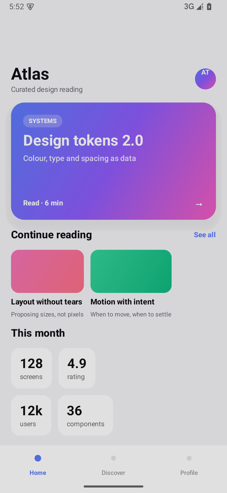
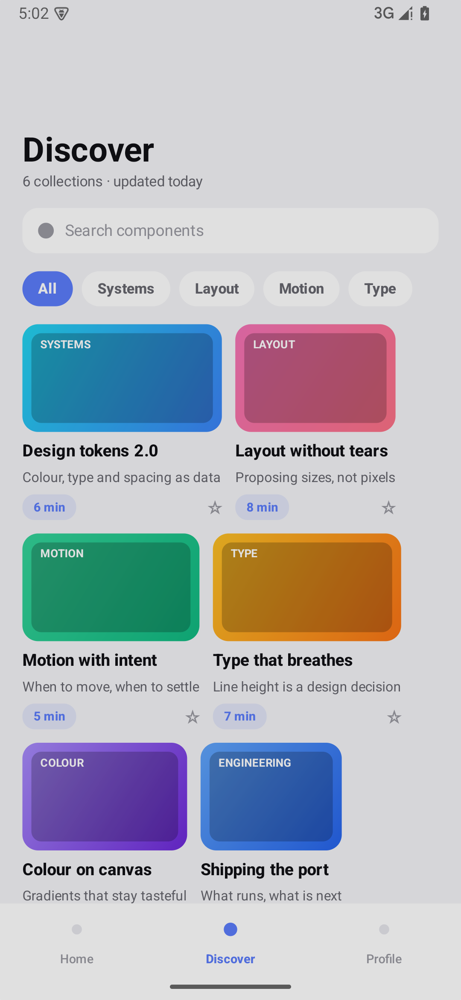
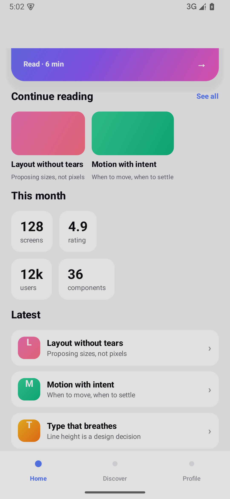

# Atlas — the demo application

A multi-screen product UI running on the port, on a real Android device. Not a renderer test:
it has navigation, scrolling, tabs, toggles, a grid, a detail feed and a colour/type ramp of its own.

| | |
|---|---|
| **Home** | gradient hero card, "Continue reading" pair, 2×2 metric tiles, feed rows with gradient badges |
| **Discover** | search field, selectable category chips, two-column card grid with category overlays and save state |
| **Detail** | push/pop navigation, gradient header, article body, bullet highlights, like/save actions that mutate state |
| **Profile** | circular avatar, stat tiles, three switch rows, about card, reset action |




## How it is put together

`Sources/DemoApp/AtlasApp.swift` is the app — ordinary SwiftUI, nothing else:

```
AtlasModel      ObservableObject: selected tab, pushed detail id, liked/saved sets, toggles
AtlasRootView   @StateObject; switches on that state, overlays the tab bar
HomeScreen · DiscoverScreen · DetailScreen · ProfileScreen      plain Views
Components      SectionHeader, CategoryPill, FeedRow, GridCard, MetricTile, SwitchRow, TabBar
```

Navigation is state, not `NavigationStack`: a non-nil `model.detail` shows `DetailScreen` in place
of the tab content while the tab bar stays on top. The port does not implement Apple's navigation
and tab *containers* yet, so the demo uses the pattern apps used before them — which keeps it
honest about what actually works.

The engine-level Atlas (`AtlasScene.swift`, `DemoTheme.swift`, `NodeBuilders.swift`) builds the same
screens directly as `LayoutNode`s — `measure → place → paint → DisplayList`, `hitTest` for input. It
predates the adapters and is built only in the engine-only configuration
(`SWIFTUI_PORT_GENERATED=0`), as the reference for the engine on its own.

## What the demo exercised (and fixed) in the engine

Building a real app shook out six bugs that a one-page test never would:

1. **Shadows inflated layout** — a shadowed card measured larger than its parent and overflowed.
   Fixed: shadows paint outside the layout box and never change the reported size (SwiftUI
   semantics), with an optional corner radius so they follow rounded shapes.
2. **Offsets inflated layout** — same class of bug, fixed the same way.
3. **`ZStack` was a vertical stack** — it had been modelled as `stack(axis: .vertical)`, so
   overlapping children were being laid out in sequence. Now a real overlay container.
4. **Gradient fills dropped corner radius** — every rounded card and avatar painted square.
5. **Text ignored frame alignment** — glyphs sat at the leading edge of centred boxes; text now
   honours its alignment within the measured frame.
6. **Protocol extension dispatch** — `handleDrag` was only defined in a `PortScene` extension, so
   it was statically dispatched and scrolling silently never reached the scene. It is a real
   protocol requirement now.

## Fidelity: the app source is ordinary SwiftUI

`demos/AtlasSwiftUI.swift` is a verbatim copy of that app file. `scripts/port/check-demo.sh`
typechecks it against Apple's retargeted `SwiftUI` interface **alone** — none of this engine is on
the include path — so "this is genuine SwiftUI source" is checkable without trusting the build:

```bash
./scripts/port/check-demo.sh          # demo typecheck: OK (AtlasSwiftUI.swift)
```

The same source also ships: it compiles into the APK against those declarations plus the renderer
([docs/RENDERER.md](RENDERER.md)). Of the 608 view-graph entry points Apple's interface declares,
the ones this app touches are implemented; anything else traps through `_suiUnimplemented` and
names itself, so the boundary is visible rather than approximate.

## Interaction proof

Scrolling, tab switching and push/pop are driven through the same `MotionEvent → JNI → Swift →
invalidate → repaint` path as any native app:


