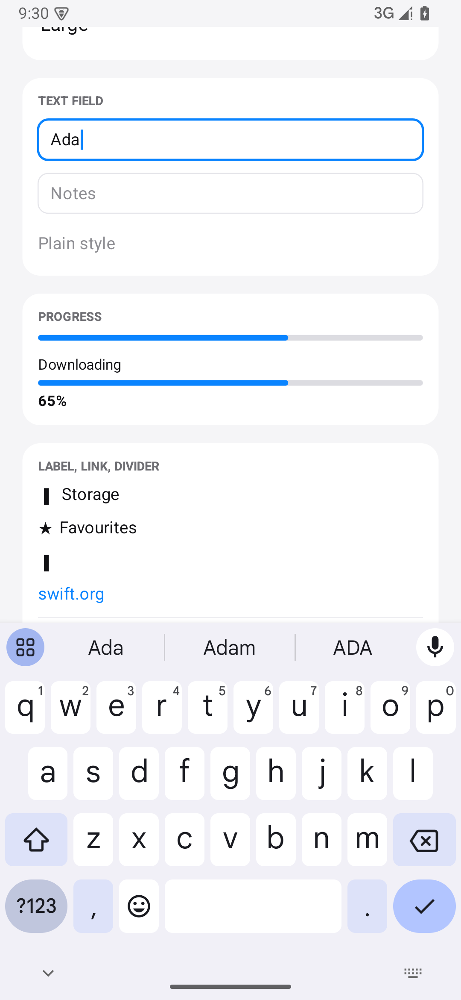
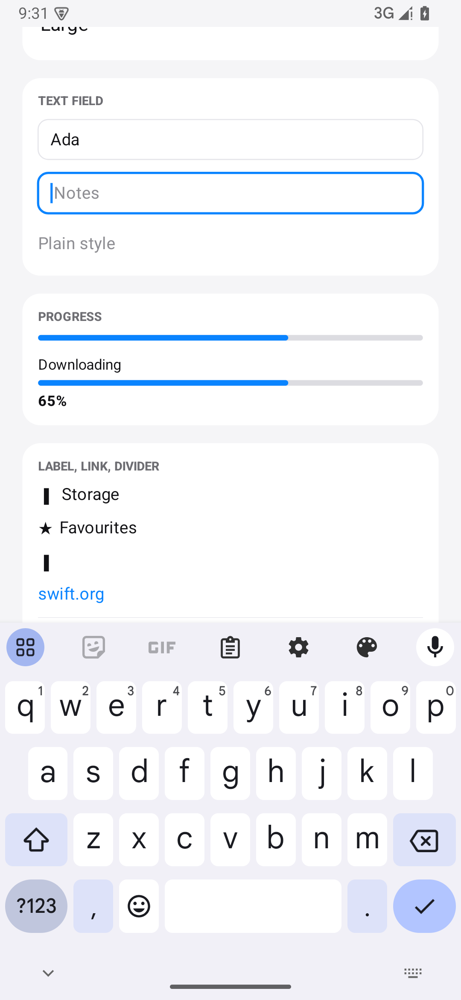

# The control gallery — the second demo app

`Sources/DemoApp/ControlGallery.swift` is a standalone app that exercises SwiftUI's controls
through the port. It ships as its own APK with its own application id
(`dev.swiftui.android.gallery`), next to the Atlas demo — two icons on the launcher, no switcher.

```bash
./scripts/gallery.sh                 # build, install, launch, screenshot
./scripts/gallery.sh --no-install    # only build build/SwiftUI-Gallery.apk
./scripts/build-apk.sh --demo gallery   # package an already-built library
```


## Why a second app instead of a screen inside Atlas

The two demos test different things and would fight over one binary: Atlas is a four-screen app
that stresses navigation, scrolling and layout; the gallery is a dense page of interactive
controls that stresses bindings, gestures and text input. Keeping them apart also keeps each
demo's APK honest — what you install is one demo, with no dead code for the other.

The demo is selected at compile time (`SWIFTUI_DEMO_GALLERY=1` → `-DPORT_DEMO_GALLERY`), so
`SwiftUIHostScene` hosts `ControlGallery()` in one build and `AtlasRootView()` in the other.

## What the gallery demonstrates

Each control is Apple's declared type, rendered by this project's adapter and driven through its
`Binding`. The header prints live state (`40% · n=3 · mode=1 · Medium · "" · on=true · focus=no`),
so a screenshot after an interaction is evidence that the model changed, not just the pixels.

| Section | Apple API exercised | Variants shown |
|---|---|---|
| Buttons | `Button(_:action:)`, `Button(action:label:)` | filled, tinted, disabled, composed label with `Image` + `Text` |
| Toggles | `Toggle(_:isOn:)`, `.labelsHidden()` | labelled row, hidden label |
| Sliders | `Slider(value:)`, `Slider(value:in:step:)` | continuous, stepped (0.05) with end labels |
| Stepper | `Stepper(value:in:step:label:)` | bounded `0…10`, `−`/`+` group |
| Pickers | `Picker(_:selection:content:)`, `.tag(_:)` | `Int` tags, `String` tags — the same control with two selection types |
| Text field | `TextField(_:text:)` | placeholder at rest, focused field with caret + system IME |
| Progress | `ProgressView(value:)`, `ProgressView(value:label:currentValueLabel:)` | plain bar, labelled bar |
| Label / Link / Divider | `Label(_:systemImage:)`, `.labelsHidden()`, `Link(_:destination:)`, `Divider()` | icon + title, icon only, accent-coloured link, rule |
| Styles | `.buttonStyle(_:)`, `.toggleStyle(_:)`, `.pickerStyle(_:)`, `.textFieldStyle(_:)` | `.borderedProminent` / `.bordered` / `.plain` buttons, `.button` toggle, `.inline` picker, `.plain` field |
| Modifiers | `.padding`, `.background`, `.frame`, `.shadow`, `.overlay`, gradients, `.foregroundColor`, `.font` | rounded swatches at three radii, shadow, gradient, clipped capsule |


## Text input is real: the platform IME edits SwiftUI state

A cursor, a selection and a soft keyboard cannot be drawn to a canvas, so the port hosts an
invisible Android `EditText` over the field and lets it own the IME session while SwiftUI keeps
owning the styling and the binding:

```
tap  → TextField adapter      → PortTextInput.beginEditing(slot:text:frame:onText:onEnd:)
     → SwiftUIAndroid         → JNI: the View polls nativeTextInputCommand
     → SwiftUIHostView        → transparent EditText over the field, IME opens
typing → TextWatcher          → nativeTextChanged*  (UTF-16, four units per jlong)
       → PortTextInput.hostTextChanged → binding → next frame draws the new text
```

`Sources/SwiftUI/Adapters/PortTextInput.swift` declares that seam; `SwiftUIAndroid` installs it
at startup, so the framework module never depends on the platform. Typing also asks for a frame
(`AndroidRuntime.invalidate`), because an edit arrives outside any draw.



An empty but focused field draws the caret *before* the placeholder, because the insertion point is
the start of the field — the placeholder is not text:



## Styles are real environment values

`.buttonStyle(.borderedProminent)` and friends are not decoration here: the modifier writes
`PortEnvironment.buttonStyle` (Apple writes `\.buttonStyle`), and the control's adapter reads it —
the same shape Apple's own modifiers have. The *style types* ship bodyless, so the port recognises
the built-in ones by type and draws equivalents (`Adapters/PortStyles.swift`):

| Modifier | Recognised styles | Result |
|---|---|---|
| `.buttonStyle(_:)` | `.borderedProminent`, `.bordered`, `.plain`/`.borderless` | filled accent capsule, outlined capsule, plain accent label |
| `.toggleStyle(_:)` | `.switch`, `.button` | iOS switch, or a capsule button reflecting `isOn` |
| `.pickerStyle(_:)` | `.segmented` (and the default), `.inline` | segmented control, or a list with a check mark |
| `.textFieldStyle(_:)` | `.roundedBorder` (and the default), `.plain` | outlined plate, or bare text |

**A user-defined style cannot work this way**: its drawing lives in `makeBody`, which the interface
only declares. That is a recorded gap, not a silent one.

## Scrolling follows the finger

Two defects fixed here, both visible only on device:

- **Cumulative translation.** A drag reports its translation from touch-down, and the store added it
  to the *current* offset on every move event, so the page accelerated away from the finger.
  `ScrollModel.track(_:)` now fixes a base offset at `.began` and re-derives `base - translation`.
- **Unreachable bottom.** The store used the height the parent *proposed* (891 dp) as the viewport,
  but the root is placed inside the safe area (835 dp), so the page's last 56 dp could never be
  scrolled into view. `LayoutNode.layoutHook` reports the frame a node was actually placed with,
  and the scroll store adopts it as the viewport. Measured on device: `content=2013 viewport=835
  max=1177 offset=1177` at the bottom, with the card padding visible.

## `Link` opens its destination

Tapping a link asks the platform through `PortLinkOpener` (the same seam pattern as text input);
`SwiftUIAndroid` installs a handler that the host view pulls once per frame, and the Java side
starts `Intent.ACTION_VIEW` with `Uri.parse(url)`. Verified on the emulator: tapping `swift.org`
logged `link open https://swift.org` and Chrome came to the front. A device without a browser logs
one warning instead of crashing.

## What is still missing (visible on purpose)

- **Custom styles.** See above: only Apple's built-in styles are drawn, because a custom
  `makeBody` is Apple's binary.
- **`.menu` and `.wheel` pickers.** They fall back to the segmented rendering (recognised as
  `.inline`), so a menu does not pop up.
- **`ProgressViewStyle` / `.circular`.** Only the linear bar is drawn; a ring needs arc strokes the
  engine does not have.
- **SF Symbols are text glyphs.** `Image(systemName:)` maps a name onto the closest character
  (`★`, `♥`, `⌕`, …), so symbol-heavy layouts are approximations.
- **`Divider` orientation, indeterminate `ProgressView()` and `SecureField`** are not implemented
  yet; `Divider()` and the determinate progress forms are.
- **Focus does not always end with the IME.** Pressing BACK closes the keyboard but the session
  stays live (the field keeps its accent ring and caret) until another field is tapped.
