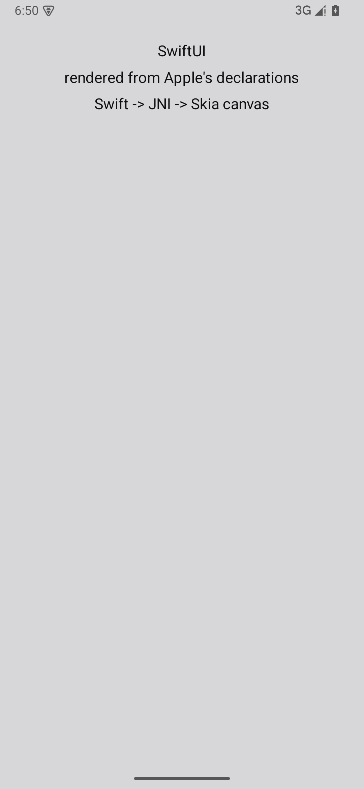

# Port status

Living document. Updated as the port converges. Numbers are measured, not estimated.


### Next: putting the full Atlas app on the ported path

`demos/AtlasSwiftUI.swift` (521 lines, four screens) compiles for Android but does not yet run:
its `@Binding` / `@ObservedObject` attributes fail with *"generic struct 'Binding' cannot be used
as an attribute"*. Two changes must land together, because each alone leaves the build broken:

1. **Restore `@propertyWrapper` on the wrapper types.** The generator rebuilds type declarations
   and drops that spelling; `restore_property_wrapper_attributes()` in
   `scripts/port/inject_bodies.py` implements it and is currently gated behind `if False:`.
2. **Keep the `wrappedValue` declarations in the generated file.** The attribute machinery
   requires the property to be declared on the type, but the engine currently omits those
   declarations (`port-impl/implemented.txt`) and supplies extensions instead — which it rejects.
   The fix is to stop omitting them and give the accessors bodies via `port-impl/bodies.txt`
   occurrence selectors (`Symbol#1` = getter, `Symbol#2` = setter), the mechanism already used for
   `LocalizedStringKey.StringInterpolation`.

Affected symbols: `Binding.wrappedValue`/`projectedValue`, `State.wrappedValue`/`projectedValue`,
`LazyState.wrappedValue`/`projectedValue`, `StateObject.wrappedValue`/`projectedValue`,
`ObservedObject.projectedValue`.

## Ported path: what renders today

Every row below is Apple's API, recompiled for Android and executed by the port's engine; the
screenshot is `docs/screenshots/ported-list.png`.

| Area | Implemented |
|---|---|
| Layout | `VStack`/`HStack`/`ZStack` (variadic `TupleContent`), `Spacer`, `padding`, `frame` (fixed + flexible), alignments, `EdgeInsets`, `Edge.Set` |
| Shapes | `Rectangle`, `RoundedRectangle`, `Circle`, `Capsule`, `_ShapeView` with `Color` / `LinearGradient` fills |
| Colour & type | `Color` (statics, `init(red:green:blue:)`, `opacity`), `Font` (+`Font.Weight`), `.font`, `.fontWeight`, `.foregroundColor`, `.foregroundStyle` — `Text` styling composes on the value itself |
| Effects | `.background`, `.overlay`, `.clipShape`, `.shadow`, `.opacity`, `.cornerRadius` (via clip) |
| Interaction | `Button` (all title inits, `action:label:`), taps through the engine's hit test, `@State`, `Binding`, `LazyState` (what Apple's macro emits), string interpolation in `LocalizedStringKey` |
| Lists | `ForEach`, `ScrollView` with drag scrolling, `Axis.Set` |

Known gaps/rough edges: no `LazyVGrid`/`Image`/`Divider`/animations yet, no `@ObservedObject`
(the vendored Combine makes it feasible), `@State` slots are keyed by wrapper creation order (a
conditional that changes wrapper count shifts later slots), and one cosmetic text-drawing overlap
in the two-line stat cards.

## The ported renderer draws (this round)

The recompiled framework now *runs on a device*: the app links Apple's declarations, the graph
context materialises a view tree, the engine measures/places/paints it, and Skia shows the result.



What made the difference, in order:

1. **Platform modules became package targets.** `UIKit`, `CoreGraphics`, `Symbols`, `Combine`, …
   are SwiftPM targets in the ported build instead of prebuilt interface modules linked by hand.
   SwiftPM then links their object code itself, which removed the whole "which archive member
   supplies this metadata?" class of failure.
2. **A real Combine.** Apple ships none for Android, so `Sources/Combine` vendors OpenCombine
   (MIT) at a pinned commit and compiles it under the module name `Combine`, with a pthread-based
   C helper layer in `Sources/COpenCombineHelpers`.
3. **`Symbols` and `DeveloperToolsSupport` became shims** transcribed from Apple's interfaces.
   Their types are only referenced by SwiftUI's declarations, so identity is all that is needed.
4. **The engine dispatches primitives existentially** (`_PortRenderable`) instead of relying on
   `View._makeView` witness tables, whose storage lives in Apple's binary. Adding a primitive is
   now a one-file change.
5. **Stored constants got real values**: alignments (`PortAlignment.swift`), `Edge.Set`,
   direction sets, `EdgeInsets`, and a body-override mechanism (`port-impl/bodies.txt`) for stubs
   that must stay declared — e.g. an `OptionSet`'s `init(rawValue:)`.

Run it:

```bash
./scripts/port/build-port-sdk.sh        # retarget interfaces + shims + vendored Combine
./scripts/ported-dev.sh                 # build, package, install, launch, report the next gap
```

`SWIFTUI_PORT_GENERATED=1` stays opt-in: the default build is still the engine-level app, so the
repository always has a product that builds without the port SDK.

## Bottom line

**Apple's compiled SwiftUI cannot run on Android.** It is a Darwin Mach-O dylib bound to
UIKitCore, QuartzCore/CA::Render, Metal and CoreText. Anyone who claims to run it on Android is
either streaming frames from a Mac/simulator or has reimplemented the API.

What this repository does instead is a genuine port of the framework's *publishable* half:

1. Apple's own module interfaces (`SwiftUI`, `SwiftUICore`, `Symbols`, `Combine`) are retargeted
   and recompiled for `aarch64-unknown-linux-android`, so application code compiles against
   **Apple's exact declarations** — types, generics, availability, result builders, SPI.
2. `@inlinable` bodies (1,022 of them across the two interfaces) are Apple's real code and are
   preserved verbatim, so they execute natively on Android.
3. Everything the interfaces declare but do not implement is supplied by this project's engine,
   drawing through Android's native Skia `Canvas`.

## Measured progress

| Area | State | Evidence |
|---|---|---|
| OSS Swift 6.4.3 toolchain, official Swift SDK for Android, NDK r30 | working | `swift build --swift-sdk swift-6.4.3-RELEASE_android --triple aarch64-unknown-linux-android28` → ELF aarch64 |
| Apple interface retargeting (`build-port-sdk.sh`) | `SwiftUICore`, `SwiftUI`, `Symbols`, `Combine` retarget clean | `build/port-sdk/gen/**` |
| Fidelity probe (`scripts/port/probe.swift`, real SwiftUI source) | 108 errors, all first-wave `SwiftUICore` (`FoundationShims`, `Spatial.Size3D`, `CoreText.LineHeight`, `ObjectiveC.NSObject`, `Accessibility.AXChartDescriptor`) | `build/port-sdk/probe.log` |
| Platform shims | `CoreGraphics` (incl. `CGBlendMode`), `CoreTransferable`, `os`/`OSLog` done; `FoundationShims`, `ObjectiveC`, `QuartzCore`, `CoreText`, `Accessibility`, `Spatial`, `UIKit` in progress | `port-shims/**` |
| Apple declarations → compilable source | 11,197 declarations, 4,018 types, 8,102 bodies injected, 1,797 printed bodies kept (704 `@inlinable` ones verbatim) | `Sources/SwiftUI/Generated/`, `build/port-sdk/injected-bodies.json` |
| Generated port in the app target | **opt-in** (`SWIFTUI_PORT_GENERATED=1`), until the shims close | `Package.swift` |
| C JNI bridge (`AndroidBridge.c`) | complete: 10 JNI entry points, 22 drawing primitives, cached paints/typefaces, exception-safe | compiles for arm64 + x86_64 with `-Wall -Wextra` |
| Java host (`MainActivity`, `SwiftUIHostView`) | complete: edge-to-edge, insets, gestures, back, config survival | APK validated with `apksigner`/`zipalign` |
| APK pipeline (`build-apk.sh`) | complete: aapt2 → javac → d8 → zip → zipalign → sign, bundles Swift runtime dylibs from `llvm-readelf` NEEDED | `build/SwiftUI-Android.apk` |
| Emulator harness (`emulator.sh`, `device-test.sh`) | complete: headless API 35 arm64, install→launch→screenshot→crash assertions | `build/screenshots/**` |
| Engine: display list, painter, frame loop | complete for the proof path | 8 host tests green (`swift test`) |
| Engine: layout/scroll/hit-test/display list | complete, exercised by the Atlas demo | `Sources/SwiftUI/Engine/**`, `docs/DEMO.md` |
| Demo app (Atlas: home / discover / detail / profile, tabs, scrolling, toggles) | running on the emulator | `Sources/DemoApp/**`, `build/screenshots` |
| Apple declarations generated (11,197 decls, 8,102 bodies, 704 inlinable preserved) | committed, opt-in, **0 errors** in the package gate | `Sources/SwiftUI/Generated/**`, `docs/PORT-BODIES.md` |
| Engine: view graph adapters (`_makeView` for Text/stacks/modifiers) | next — the generated gate is green, engine work can start | 611 seams listed in `build/port-sdk/injected-bodies.json` |

## What the interfaces actually expose (and why that matters)

Apple's interface is unusually generous: it declares the engine seam itself.

```swift
public protocol View {
  nonisolated static func _makeView(view: _GraphValue<Self>, inputs: _ViewInputs) -> _ViewOutputs
  nonisolated static func _makeViewList(view: _GraphValue<Self>, inputs: _ViewListInputs) -> _ViewListOutputs
  nonisolated static func _viewListCount(inputs: _ViewListCountInputs) -> Int?
  associatedtype Body: View
  @ContentBuilder @MainActor var body: Body { get }
}
```

`_GraphValue`, `_ViewInputs`, `_ViewOutputs`, `_ViewListInputs`, `_ViewListOutputs`,
`_ViewListCountInputs` are opaque in the interface (their storage is internal), which means the
port can define their real contents. That is the architecture the port implements: a value graph
per frame → node tree → propose/measure/place → `DisplayList` → Android canvas.

## Two compiler-level discoveries worth recording

Both were found by trying to compile Apple's interface back from text, and both are genuine
Swift 6.4.3 behaviour, not port bugs:

1. **`$`-prefixed declarations are illegal in source and crash the frontend.** Apple's interface
   lists a property's projected value explicitly (`public var $isOn: Binding<Bool> { get }`).
   Declared literally, the compiler first rejects the name, and once the wrapper is present it
   segfaults in `PropertyWrapperAuxiliaryVariablesRequest`. The projection is synthesized from
   the wrapped property anyway, so the declaration is dropped
   (`scripts/port/strip_projected_vars.py`).

The generated declaration module now compiles for Android with **0 errors**
(`SWIFTUI_PORT_GENERATED=1 swift build … --product SwiftUIAndroidApp`).
2. **A property-wrapper attribute on a declaration that spells out its own accessors is
   malformed** — interfaces emit exactly that shape (`@Binding public var isOn: Bool { get }`).
   The port drops the attribute and supplies wrapper semantics in the engine.

## Known semantic gaps (by construction, not by accident)

| Gap | Why |
|---|---|
| No ObjC interop | Android has no ObjC runtime; `@objc` attributes are stripped when retargeting. UIKit-facing API is declarative only. |
| No Metal / CoreAnimation | rendering goes through `android.graphics.Canvas` (Skia, hardware accelerated), not CA::Render. |
| No CoreText | text shaping uses Android's `Paint`/`Typeface` (HarfBuzz under the hood) through the bridge. |
| No UIKit | `UIView`/`UIColor`/`UIImage` are declaration-faithful shims; bridging an actual `UIView` into the tree is impossible on Android. |
| Foundation must be dynamic | the Android SDK ships Foundation as dylibs (~74 MB bundled), so APK size is dominated by the Swift/Foundation runtime, not the port. |
| Three conformance clauses omitted | `Optional`/`_ConditionalContent`: `SliderTickContent` and `GestureStateGesture`: `Gesture` require associated-type witnesses that contradict the same type's `View`/`TabContent` witnesses; Apple relies on per-module witness shadowing, which one module cannot express. Only the clause is omitted; every omission is recorded in `injected-bodies.json` (`incompatible_conformances_omitted`) and `docs/PORT-BODIES.md` R14. |

## Reproduce

```bash
./scripts/port/build-port-sdk.sh          # retarget Apple interfaces + fidelity probe
./scripts/dev.sh                          # cross-compile → APK → install → screenshot
swift test                                # host-side engine tests
```
